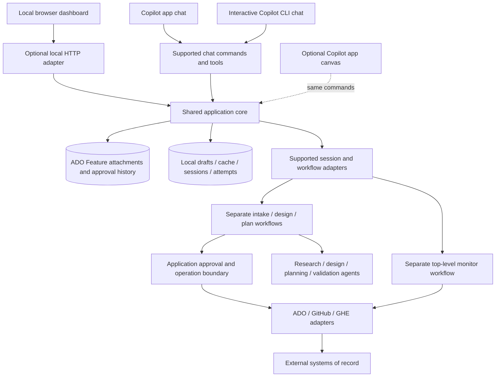

<!-- Copyright (c) Microsoft Corporation. All rights reserved. -->

# Software Factory: dynamic workflows, chat, and local-first UI implementation plan

**Status:** ADO-backed team authority and separate stage workflows are implemented; live ADO pilot and human-graded model evaluations remain rollout gates.
**Baseline:** `origin/master`, commit `1c7efd1b2`, inspected on 2026-10-26.
**Scope:** Developer tooling in `android-complete`, not Android authentication runtime behavior.

### Current implementation boundary

The [implementation](../tools/software-factory/README.md) connects native
`software-factory-design`, `software-factory-plan`, and
`software-factory-monitor` workflows to a shared TypeScript core with ADO authority
and a local SQLite draft/cache/execution store,
app/CLI chat tools and user slash commands, and the optional React UI.
Plain-language intake allows saving an idea before success criteria are known.
The optional native `software-factory-intake` workflow proposes criteria and
open questions only; reviewing/editing, saving and approving remain distinct.
The team-aligned direction follows PR #478: publish requirements/artifacts as
versioned attachments on an existing ADO Feature; attribute exact-scope approvals
to the authenticated ADO editor following genuine host confirmation. Stage runs
end before review. Backlog creation and dispatch are separate deterministic
commands, not a workflow spanning human approval. Private drafts remain local.
The unchanged design engine from #477 and requirements template from #476 are
reused. The product-spec commit itself is not merged into this branch by these edits.
The UI assigns IDs automatically and accepts ordinary text, bullets and pasted
legacy labels instead of requiring a requirements syntax.
The dashboard emphasizes current progress, the next relevant decision and a
shared activity history. It refreshes saved chat/UI state even while idle,
preserves unsaved drafts, and surfaces failed startup attempts before technical
run details. Installation verifies the matching SDK platform dependency.
Conversational progress also records the current investigation, intended
deliverable, next step and reason for any user question. This is separate from
native execution/approval authority: better orientation does not remove the
existing explicit gates. Chat researches technical details before asking the
engineer to make material scope/compatibility decisions.
Scope decisions (`blockingUnknowns`) are distinguished from engineering
obligations (`designTasks`), so the scope gate does not require the design to be
finished before starting design. The approved obligations are passed to design
workers and independent review. SDK diagnostics and owned execution are pinned
to the project's public SDK exports, independent of chat-host SDK aliases.
Consent presentation separates scope approval from execution and remote-effect
authority. Structured host choices replace the generic `confirmed` checkbox
where supported; the concise main prompt has a complete opt-in readable review.
This presentation change does not alter exact-scope/provenance enforcement.
Reviews have actionable handoffs: after showing full details, chat presents
Approve / Request changes / Decide later rather than waiting for an unstated
typed phrase. Human-input state is distinct from active work and deliberate
pause; review IDs carry no approval authority.
Owned native startup now pins the runtime executable/transport and performs a
same-session extension registration handshake before start/resume, binding the
requested workflow and loaded code fingerprint. Diagnostics probe every production
workflow name through its zero-agent scope guard and cover nested extension-host
execution; a generic check in another process is not considered proof of readiness.
Extension launch additionally verifies an external Node 24+ interpreter instead
of using the app host's `process.execPath`. Embedded hosts can name a packaged
Copilot executable there; that case is covered by a nested zero-agent regression
and executable-selection receipts.
It includes independent design/plan review, durable human gates, provider
backlog/dispatch receipts, dependency waves, monitoring/validation, explicit
PR feedback, native run control, local schedules, legacy import/export, and recovery.
The existing standalone `design-feature` stays compatible.

**Cross-interface continuation remains incomplete.** Joined-session chat execution,
scoped read-only workers and dashboard start/resume routing to that same native
owner are implemented with a real zero-agent integration check. It verifies
native read delegation, canonical session identity and original-journal resume
without another SDK session. Session bindings, resident-owner leases and
one-time native admission claims prevent silent ownership changes and duplicate
submissions. Lifecycle-state v2 is read-compatible with v1; older loaded
integrations fail closed on new ownership state, and isolated restores clear
bindings/leases as well as schedules/controls.

Shared registry records do
not make an SDK session discoverable in the Copilot app or stream its workers
into the originating chat. Chat-native execution and app-visible publication of
dashboard/standalone-CLI sessions are required by R20 below. The installed SDK
exposes experimental authenticated AHP hosting and explicit publication of the
same resident session; desktop discovery/attachment must be verified separately.
Public app deep links open known app-local session IDs, not arbitrary SDK
session IDs, and cannot be used to manufacture adoption.

Native registration, checkpoint persistence, and cold resume are verified with
zero agents against the actual SDK/runtime. The lifecycle functions and provider
contracts are exercised with deterministic agents/providers; this does not prove
paid model quality or account-specific live dispatch/onboarding. Live paid and
remote-mutation acceptance still needs an explicitly approved pilot.

Design is a separate top-level wrapper so its existing resource bounds remain
native, not implicitly inherited by a larger workflow. Lifecycle and monitor
compose ordinary helpers, not nested workflows. Standalone ADO integration uses
authenticated CLI/REST at the provider boundary rather than assuming ownership of
the conversation's MCP credentials. A host-specific MCP transport can implement
that boundary without changing workflow, approval, or receipt semantics.

## 1. Executive decision

Build **Software Factory**, the team-aligned name for our feature-development tooling, backed by Copilot Dynamic Workflows. Provide three first-class ways to use it: the web UI, chat in the Copilot app, and interactive Copilot CLI chat. Replace our custom execution coordination with the workflow runtime, while retaining specialist agents, project policies, and explicit ADO/GitHub adapters.

Do not build another general-purpose Copilot client. Copilot continues to provide model access, agent execution, conversation sessions, workflow journals, and execution observability. Software Factory provides a shared application layer for requirements, designs, plans, approvals, dependencies, work items, pull requests, and recovery actions, exposed through both conversational and visual interfaces.

The UI is optional. An engineer must be able to complete the full lifecycle directly in either chat client without opening a browser, running the dashboard, or installing its frontend bundle. Shared local persistence and runtime components may be initialized through the supported chat integration; the HTTP/web presentation service is not a prerequisite for chat-only use.

Start with per-developer local operation and a web UI served on loopback when requested. A Copilot app canvas can later expose the same application layer; this optional canvas is distinct from required Copilot app chat support. A native desktop shell, hosted team service, and consolidation of other operational tools are outside the initial implementation.

### Confirmed direction versus proposed implementation

| Category | Decision |
|---|---|
| Confirmed direction | The team-aligned product name is Software Factory. |
| Confirmed direction | Prefer the Copilot app over preserving VS Code-specific integration. |
| Confirmed direction | Full lifecycle support in the UI, Copilot app chat, and interactive Copilot CLI chat is required from the initial supported release. |
| Confirmed direction | All interfaces use the same domain commands, feature records, approvals, and workflow definitions; the UI is optional. |
| Confirmed direction | Use Dynamic Workflows for execution instead of expanding a custom orchestration engine. |
| Confirmed direction | Provide a purpose-built UI, informed by the dashboard/worker separation in `icm-tracker` and `pr-reviewer`. |
| Confirmed direction | Preserve human approval, durable feature records, and explicit recovery. |
| Confirmed direction | A shared TypeScript core with versioned ADO Feature attachments as team authority; SQLite stores private drafts, caches, local sessions and attempts. |
| Proposed implementation | Supported native chat-session and SDK integration; select execution adapters from verified capabilities, not from a requirement to use the dashboard. |
| Confirmed direction | Separate intake, design, plan and monitor workflows end before human review. Explicit backlog/dispatch commands follow their own approvals. |
| Deferred decisions | Exact chat/runner integration, local process hosting, installation packaging, and optional canvas interoperability require the first milestone's evidence. |

Approval of this document is not authorization to run paid workflows, create remote work items, dispatch coding agents, publish artifacts, or merge changes.

## 2. Applicable systems and existing baseline

### Applicability and priority

| System | Applicability |
|---|---|
| Local developer workstation | Initial target; Windows-first verification without unnecessary platform-specific coupling. |
| Copilot app chat | Required first-class conversational interface for the complete lifecycle, including review and approvals. |
| Interactive Copilot CLI chat | Required first-class conversational interface with the same lifecycle and domain behavior. |
| Copilot SDK / native workflow APIs | Supported execution, integration, and session ownership; not a separate user-facing prerequisite to operate manually. |
| Local web UI | Required visual interface, optional to run or install for an individual chat-only engineer. |
| MSAL, Common/common4j, Broker/broker4j, ADAL, OneAuth, Authenticator | Research and repository-routing targets; no authentication API or IPC changes in this plan. |
| ADO Boards and GitHub/GHE/ADO repositories | Existing external systems of record for work items and PRs. |
| 1ES production pipelines | Observe relevant PR/build status where supported; no pipeline changes or deployments in the initial scope. |
| Existing VS Code extension | Compatibility reference, not a required client or a new investment target. |

### Important correction to the earlier research baseline

The latest default branch already contains a repository-scoped Dynamic Workflow:

- Entry point: [DevDesignDoc extension](../.github/extensions/DevDesignDoc/extension.mjs).
- Invocation name: `design-feature`.
- Implementation: [workflow.mjs](../.github/extensions/DevDesignDoc/workflow.mjs).
- Contract and limitations: [workflow README](../.github/extensions/DevDesignDoc/README.md).
- Existing offline coverage: [workflow.test.mjs](../.github/extensions/DevDesignDoc/workflow.test.mjs).

This is an implemented design-only workflow, not the complete proposed application. It requires approved, revision-bound Stage 0 requirements, gathers evidence, authors a structured design, validates traceability, and performs independent review with at most two fixes. It returns a human gate packet; it does not write design documents, create PBIs or PRs, approve planning, or call `ctx.pause()`.

Its automated `GO to Planning` recommendation always leaves `humanApproval` pending. Preserve that distinction. Its existing limits are one concurrent agent, seven total agents, 1,800 seconds, and 20 AI credits; those are existing implementation settings, not newly proposed budgets for the full lifecycle.

**User-directed correction (2026-10-28):** Software Factory must not inherit the
standalone helper's 20-credit cap. Factory retains its agent/time/fix bounds and
approval gates, but new runs are uncapped in the credit dimension unless the user
explicitly supplies a ceiling. Explicit `maxAiCredits: null` can clear a ceiling
on a separately authorized resume; historical usage and approvals are preserved.

The previous feature-orchestrator research inspected a different branch. Its finding that no Dynamic Workflow implementation was present does not describe this new default-branch baseline.

### Existing components and retirement outcome

**User-directed consolidation (2026-10-28):** Software Factory replaces Feature
Orchestrator. Remove the old plugin/VS Code registrations, mutation agents,
global-state hooks and setup workflow. User-facing feature skills route to
Factory; workers read domain references with a single schema-bound read-only
contract, not mode-switching skills. Preserve historical user files and explicit
import. Installed copies and cached chats require user-side removal/reload.

| Component | Current responsibility | Planned treatment |
|---|---|---|
| [Software Factory agent](../.github/agents/software-factory.agent.md) | Shared feature entry point | Replaces the removed root orchestrator agent; feature commands/skills route here. |
| [Retired agent plugin](../feature-orchestrator-plugin/README.md) | Former duplicated agents, skills, commands and hooks | Removed registration and executable paths; migration notice only. |
| `DevDesignDoc` / `design-feature` | Guarded, evidence-backed design generation | Reuse its design algorithm and preserve its standalone contract. |
| Removed workspace/plugin state CLIs | Former JSON artifact tracking | Preserve user JSON and explicit import, not competing writers. |
| Removed subagent start/stop hooks | Inferred the most recently updated active feature | No automatic context injection or phase advancement. |
| [Retired VS Code extension](../extensions/feature-orchestrator/README.md) | Former dashboard, review comments, manual artifacts | Removed source/package registration; migration notice only. |
| Personal operational dashboards | Durable requests, background workers, structured findings, explicit human actions | Reuse architectural lessons, not private data, machine-specific configuration, or wholesale copies. |

Existing migration hazards include two state directories, `artifacts.design` versus `artifacts.designSpec`, and inconsistent completion rules. The new registry must handle these explicitly instead of making another incompatible variant.

## 3. Problem description

The existing pipeline mixes three concerns:

1. Domain decisions: what the feature requires, which design is approved, and which work depends on other work.
2. Execution coordination: launching agents, passing results, tracking progress, and resuming interrupted runs.
3. Presentation: showing designs, PBIs, PRs, comments, and next actions.

Prompt-based coordination and global JSON state make it difficult to prove which feature an agent belongs to, whether approval covers the current revision, or whether a resumed mutation has already succeeded remotely. A VS Code-specific UI is also no longer the team's primary work surface, and many engineers prefer completing the existing feature-orchestrator flow entirely in chat.

The replacement should answer "what needs my attention?" across features without reproducing Copilot chat or hiding the underlying evidence and execution history. A new UI must not remove chat-only operation or turn chat into a launcher that redirects engineers to the browser for substantive work.

## 4. Requirements (Must)

| ID | Requirement |
|---|---|
| R1 | Identify every project, feature, artifact revision, execution, work item, and PR explicitly; never attribute work to the latest active feature by inference. |
| R2 | Capture a plain-language feature brief, checkable success criteria, non-goals, open questions, source context, and explicit human approval before design execution. Draft briefs need not already contain finalized criteria; optional AI intake proposes them for review, never approval. |
| R3 | Preserve the existing guarded design workflow's evidence, traceability, independent review, bounded fixes, and pending-human-approval semantics. |
| R4 | Represent approvals as durable, action-scoped decisions bound to immutable artifact revisions and intended external targets. |
| R5 | Use Dynamic Workflows for agent sequencing, journaled results, checkpoints, and bounded parallel work; do not implement another generic execution engine. |
| R6 | Persist feature/business records independently of workflow journals, with transactional writes, schema versions, audit history, and restart recovery. |
| R7 | Make external mutations idempotent or reconcilable across crashes, retries, ambiguous responses, and explicit recovery. |
| R8 | Route by provider, hostname, repository identity, module, configured base branch, and account; support GitHub.com, GHE, and ADO without conflating them. |
| R9 | Dispatch only approved PBIs whose live dependencies are satisfied; preserve self-contained, single-repository PBI specifications. |
| R10 | Clearly distinguish runtime completion, phase completion, feature completion, cancellation, and successful implementation. |
| R11 | Provide a local web UI for review, approvals, dependency inspection, artifacts, run history, blockers, and recovery without requiring VS Code; its use is optional for individual engineers. |
| R12 | Use documented Copilot interfaces; never write the Copilot app's internal database or manufacture session/workspace metadata. |
| R13 | Enforce local API and worker permission boundaries in code; treat repository text, agent output, and imported artifacts as untrusted data. |
| R14 | Preserve user-owned checkouts and unrelated changes; do not silently switch branches, stash, reset, create worktrees, commit, or push. |
| R15 | Introduce the new path incrementally with explicit backend selection, migration previews, and rollback; never automatically retry failed work through a different backend. |
| R16 | Keep initial operation per-developer and local; do not imply that local state, workflow history, or approvals form a shared team service. |
| R17 | Support the complete lifecycle directly in Copilot app chat and interactive Copilot CLI chat, without requiring the browser, dashboard process, or frontend bundle. |
| R18 | Enforce the same domain commands, artifacts, approvals, authorization, idempotency, and outcomes across all three interfaces; allow supported cross-interface continuation without duplicate work. |
| R19 | Capture approval provenance from genuine user interaction in each chat host; free-form agent output, ambiguous assent, or model-authored approval arguments cannot authorize effects. |
| R20 | Make dashboard/standalone-CLI-started feature sessions discoverable and continuable in the Copilot app, and allow app/interactive-CLI-started features to continue from the dashboard. Preserve canonical feature, conversation/session and native-run mappings, approvals, artifacts, checkpoints and workspace; switching interfaces must not copy/restart work or create competing execution owners. |

### System qualities (Must)

- **Correctness:** semantic validation follows structural schema validation; malformed or absent output cannot advance a stage.
- **Reliability:** interruption remains visible, external effects are reconciled, and recovery uses the owning session/run.
- **Security and privacy:** least-privilege workers, explicit mutation authority, secret redaction, and local-only serving by default.
- **Supportability:** actionable preflight failures, versioned contracts, stable IDs, exportable diagnostics, and clear recovery instructions.
- **Responsiveness:** each interface provides progress and recoverable long-running work; the UI does not block while agents run, and slow or unavailable providers do not erase previous results.
- **Performance and cost:** surface measured runtime and credit usage; establish targets from a representative pilot rather than inventing thresholds.
- **Compatibility:** preserve existing standalone design consumers and conversational entry points until replacements are verified; chat-only support is not deferred until UI migration is complete.

### Goals and principles (Desired)

- Reuse the specialist knowledge already encoded in agents and skills.
- Prefer deterministic code for validation and mutations, and agents for analysis and judgment.
- Show deliverables and decisions before transcripts and implementation machinery.
- Make conversational and visual interfaces thin clients of the same application core; do not privilege one as the source of truth.
- Keep one authoritative owner for each class of state.
- Share the workflow definition through the repository, not personal runtime data.
- Avoid introducing a platform/framework until multiple concrete uses justify it.

## 5. Solution options and decision

These options compare visual presentation and hosting choices. Full support for Copilot app chat and interactive Copilot CLI chat is required under every option; it is not an alternative to providing a UI.

### Option A: Copilot app canvas as the primary UI

```text
Canvas controls -> supported extension/backend -> workflows -> agents/adapters
```

**Pros:** integrated chat experience, fewer independent UI entry points, native workflow visibility.

**Cons:** feature records still need independent persistence; canvas availability, session ownership, and lifecycle behavior need verification. A canvas alone does not solve cross-session feature tracking.

### Option B: shared application core with chat adapters and a local web dashboard (recommended)

```text
App chat / CLI chat -> supported chat adapter ----\
                                                  -> application core -> workflows
Browser UI --------> optional local HTTP adapter -/                  \-> ADO/GitHub
```

**Pros:** preserves chat-only operation, matches our dashboard precedent, and keeps records and policy independent of presentation. Supports focused review screens and explicit execution ownership. A canvas can later use the same core as another client.

**Cons:** we own chat-host integration, optional local service startup, installation, transport protection, registry migration, and workflow-session reconnection. Interface parity needs explicit acceptance coverage.

### Option C: native desktop application or hosted shared service

```text
Desktop/hosted client -> application service -> workflow runtime and integrations
```

**Pros:** potentially simpler desktop launch or centralized team access, depending on the chosen variant.

**Cons:** desktop packaging adds little initial domain value; hosting adds identity, authorization, tenant isolation, concurrent ownership, credential handling, and operational responsibilities.

### Solution decision

Proceed with Option B. Build the presentation-independent application core and both chat adapters alongside the UI. Keep domain behavior independent of HTTP/browser state so chat-only use does not need the dashboard. Support Option A later without another store or workflow definition. Do not implement Option C in the initial milestones.

## 6. Scope boundaries

### In scope

- Stage 0 intake, design and plan review, backlog previews, dispatch approvals, and monitoring.
- Complete conversational operation in Copilot app chat and interactive Copilot CLI chat, including approvals, revisions, and recovery.
- Durable feature records, immutable artifacts, approvals, external-operation receipts, and run ownership.
- A shared application core, supported chat/runtime adapters, and an optional-to-run React/TypeScript dashboard and local HTTP transport.
- Compatibility with the existing read-only design workflow.
- GitHub/GHE and ADO work-item/PR integrations with explicit capabilities and provider-specific behavior.
- Read-only import and reviewed migration of existing feature state.
- Optional future Copilot app canvas over the same backend.

### Explicit non-goals

- Rebuilding chat, model routing, the Copilot session store, or the workflow scheduler/journal.
- Making an engineer open the browser to finish a chat-started operation or approval.
- Replacing `icm-tracker` or `pr-reviewer`, or unifying all tools in one platform.
- Requiring VS Code, or extending its dashboard before the new path is proven.
- Changes to Android authentication APIs, IPC contracts, production pipelines, or deployments.
- Automatic PR approval, merge, release, publication, or dependency bypass.
- Silent remote work, blanket tool approval, or unattended resolution of user decisions.
- A shared team board, hosted execution, enterprise identity system, or arbitrary remote access.
- Automatic takeover of existing checkouts or import of private operational data.

## 7. Architecture and ownership



| State or behavior | Authoritative owner |
|---|---|
| Agent scheduling, journaled workflow results, checkpoints, runtime usage | Copilot workflow runtime |
| Shared feature identity, artifact revisions, approvals, operation receipts | Versioned ADO Feature attachments with authenticated writer/ancestry verification |
| Private drafts, cached shared snapshots, run mappings, schedules, attempt evidence | Per-user SQLite store, never offline approval authority |
| Actual PBI and PR state, repository branches and commit revisions | ADO/GitHub/GHE |
| Presentation, navigation, drafts before submission | Respective UI/chat client; never authoritative for approvals or external results |

The application core is a domain boundary and runtime adapter, not another generic scheduler. It admits known commands, starts/resumes a known workflow through a supported adapter, persists domain decisions, and authorizes explicit effects. It must not duplicate the workflow's phase graph in an unrelated queue engine.

Chat adapters and HTTP handlers call the same application commands and queries, either in process or through a supported local IPC boundary. Browser sessions, rendered pages, and UI event handlers cannot contain required domain logic. A chat request must not shell out to a second copy of the legacy orchestrator or use a separate registry.

For a chat-started execution, use and record the supported native owning session rather than silently creating an unrelated dashboard-owned run. UI-started executions also record their owner explicitly. Switching interfaces reads the same feature/run mapping and routes control to that owner where supported; a different chat session cannot assume ownership or replay work merely because it knows a run ID.

Workflow history and observation are scoped to the owning session. Sharing a definition through the repository does not share its journals or restore a run in another session. If the owner cannot be recovered through supported APIs, preserve the evidence and offer an explicit successor execution after reconciliation; do not claim to have resumed or migrated the original journal.

### Required bidirectional handoff

The feature is one durable work item with multiple clients, not one feature per
interface. Preserve its conversation/session binding across phase executions;
individual workflow runs retain their own journal IDs.

| Origin | Required continuation |
|---|---|
| Copilot app / interactive CLI chat | Execute through the joined native session with worker-scoped restrictions. The dashboard observes and submits authorized actions to that same execution owner. |
| Dashboard / standalone CLI | Create or reuse a feature's owned session and publish it through a supported app/host integration. The app attaches to that session, not a second conversation with a copied prompt. |
| Both interfaces open | Both display the same phase, artifacts, pending decision and failure state. One owner controls each active native run; duplicate or stale actions cannot start another worker or resurrect approval. |

Use the SDK's public `startAhpHost` / `publishSession` surface as the candidate
for dashboard-origin publication. Keep the authenticated listener loopback-only
by default, protect its connection token, and advertise only Factory sessions.
Do not silently enable a cloud/remote environment or publish unrelated sessions.
Connection credentials are not feature artifacts and must not enter repo files,
logs, exports, or browser-visible diagnostics.

Record native SDK session identity and host resource separately from any app-local
session identity/link returned by a supported app integration. A host catalog
entry is not proof of app sidebar visibility. A deep link for a known app-local
session is not an SDK-session import API. Never insert app database rows, invent
app links from runtime UUIDs, or replace this requirement with a new kickoff chat.

Closing a browser must not stop the owner. Closing/restarting a CLI, runtime or
app must produce an explicit online/offline/recoverable state and a supported
reconnection path using the same binding and journal. Host lifetime and cold
rehydration of Factory tools/approvals are part of the handoff contract.

Acceptance requires app-to-dashboard and dashboard/CLI-to-app continuation at
research, a pending approval, paused work, successful completion and failure;
concurrent commands, disconnect/reconnect and host restart must preserve identity
and never duplicate paid work. First prove native publication/catalog recovery
with zero agents, then prove actual app discovery, attachment and worker visibility.
SDK-only publication is not sufficient to mark R20 complete.

### Proposed repository layout

```text
tools\software-factory\
  core\            Domain commands, registry, approvals, operation ledger
  chat\            App/CLI chat command, tool, consent, and rendering adapters
  web\             React/TypeScript review and dashboard UI
  server\          Optional local HTTP transport and web application hosting
  shared\          Versioned domain contracts and semantic validators
  workflows\       Lifecycle/monitor definitions and ordinary phase helpers
  tests\           Domain, runner-contract, recovery, and UI coverage

.github\extensions\DevDesignDoc\
  extension.mjs    Existing design-feature registration remains compatible

.github\extensions\SoftwareFactory\
  extension.mjs    Thin workflow and supported chat integration registration
```

These paths are proposed, not created by this document. Keep any implementation aligned with repository tooling conventions: TypeScript/ES modules for this client/runtime integration; Kotlin-first guidance continues to apply to Android application code. The existing workflow already documents this distinction.

## 8. Workflow composition and the existing design implementation

### No nested workflows

The currently inspected SDK rejects nested `ctx.workflow(...)` calls, and the workflow context does not allow starting/resuming another workflow through its session. Do not design a lifecycle workflow that invokes `design-feature` as a child workflow.

Preferred composition:

1. Keep `design-feature` registered and preserve its input/output and no-side-effect contract.
2. Reuse its exported design algorithm in the separate design workflow, with an explicit approved Stage 0 input.
3. Extract shared code only where needed; do not copy the algorithm, validators, or fixed rubric.
4. Keep monitoring as a separately invoked top-level workflow, not a nested workflow or an unbounded child.

Calling a helper does **not** inherit its workflow registration metadata, native limits, phase labels, or permission boundary. Before enabling composition, demonstrate how the lifecycle preserves the design phase's bounded fixes and effective resource/permission constraints. If equivalent protection cannot be established, keep `design-feature` as a separate top-level run and defer consolidation. Do not weaken the existing guardrails to simplify integration.

### Runtime semantics to account for

- `ctx.agent` can select an installed custom agent and return structured output. Verify name resolution and skill availability in the actual runner.
- Ordinary agent failures may return `null`; cancellation and hard runtime failures propagate. Check both paths explicitly.
- Structural output schemas are not full semantic validation. Validate IDs, references, uniqueness, nonempty fields, graph validity, and business rules in code.
- `ctx.step` journals JSON results by key. Keys must include workflow/contract version and the relevant immutable input identity.
- Journaled producers are best-effort at-least-once, not exactly-once. Use the operation ledger for external side effects.
- Identical agent calls may be memoized. Labels/prompts must identify intentional independent work and artifact revisions.
- `ctx.parallel` and `ctx.pipeline` can yield `null` items after ordinary failures. Never silently drop required coverage.
- `ctx.phase` is run-global. Use it at top-level transitions and use labels for concurrent work.
- `ctx.pause` is a one-shot durable checkpoint, used only in the main flow. It is not an approval decision.
- Nested workflows are unsupported. Reuse ordinary functions or explicitly separate top-level runs.
- Cancellation is cooperative. A provider mutation or subprocess may finish before cancellation takes effect; reconcile its actual result.

## 9. Lifecycle and human gates

### Intended lifecycle

```text
Intake -> Requirements review -> Design -> Design review
       -> Plan -> Plan review -> Backlog creation -> Backlog review
       -> Dispatch eligible PBIs -> Monitor -> Review completion
```

Each interface may combine adjacent review actions for convenience, but each action's meaning and external effects must be explicit. All gates can be reviewed and resolved directly in either chat client; a browser confirmation is not required.

| Gate | Evidence reviewed | Authority granted |
|---|---|---|
| Requirements approval | Exact Stage 0 revision, measurable requirements, non-goals, blocking unknowns | Run design against that revision only |
| Design approval | Full design, evidence revisions, traceability, review/fix history, open decisions | Begin planning; not create remote work |
| Plan/backlog approval | Exact PBI specifications, dependency graph, target projects/repos, expected operations | Create the displayed approved work items and links |
| Dispatch approval | Exact eligible PBI set, repository/host/base branch/account, costs/limits when known | Dispatch that set, not every future-ready PBI |
| Scope-change decision | Revised requirements/design/plan and affected existing operations | Replace or cancel explicitly identified future work |
| Completion decision | Actual PR outcomes, PBI outcomes, validation gaps, required human review | Mark the feature completed under the chosen policy |

Approving content is not blanket permission to publish it. Rejection, revision requests, and cancellation are explicit decisions, not missing/false approval values.

### Approval provenance

- The trusted application core records a user action through an authenticated UI or supported chat-host interaction; agents never supply their own approval.
- An approval records its target artifact hash/revision, action, repository/project targets, operation-set identity, and audit reference.
- For chat, bind the decision to the host session and actual user-response/request reference supplied by a supported interaction mechanism. Do not accept a model-authored `approved: true` or a quoted conversation excerpt as evidence.
- Interpret natural language as intent, not implicit authorization. If "approved" or "continue" could refer to multiple features, revisions, gates, or external effects, present the exact target and scope for confirmation in the current chat.
- Interactive CLI chat and programmatic/headless CLI execution are different modes. A headless run with no valid prior approval pauses/blocks explicitly; it cannot auto-approve or require a browser to obtain approval later.
- Shared decisions require authenticated ADO identity and successful work-item edit permission, in addition to genuine host confirmation. Self-approval is permitted in v1; there is no separate approver roster.
- A display string such as `approvedBy`, matching revision strings, a green validation report, or a workflow recommendation is not proof of approval.
- Make the approval record inspectable by the existing design evidence worker without exposing credentials or permitting agents to manufacture it.
- Use compare-and-swap/version checks when recording approval and when admitting the approved command.
- Editing approved content creates a new revision and invalidates dependent approvals/undispatched work. Never edit an approved snapshot in place.

### Pause/resume protocol

Persist the gate packet to ADO and end the stage run before human review. A later
explicitly authorized stage reads fresh approvals from ADO. Native checkpoints
and resume are reserved for recovery inside a stage, not business approval.

Native "Resume" must not bypass missing, rejected, or stale approval or a released
shared claim. Retired multi-stage `lifecycle` runs cannot resume. Team handoff
starts a subsequent stage in the teammate's own session; it does not copy journals.

Workflow arguments and journaled outputs are immutable for an existing execution. A requirements change or incompatible design/plan revision may require a successor run with explicit lineage rather than resuming old cached work. A code/prompt/schema/rubric change requires a new workflow version or new run when cached semantics no longer match.

Do not automatically invalidate all earlier work because expected implementation commits landed during monitoring. Distinguish requirements changes, relevant source-contract drift, and expected dependency implementation; show the affected approvals and required revalidation.

## 10. Persistence and domain contracts

Use versioned ADO Feature attachments as shared authority from publication onward.
Guard writes with work-item revisions; verify hashes, immutable snapshot ancestry
and authenticated writers before accepting approvals. Store private drafts,
verified caches and local run/attempt records in transactional per-user SQLite
outside the repository. Do not use Copilot's database or committed runtime state.

| Entity | Required identity and invariants |
|---|---|
| Project/workspace | Stable project ID, canonical checkout/repository identity, configuration version; names and paths alone are not globally unique IDs. |
| Feature | Stable feature ID, project ID, requirements revision, domain status, lineage, timestamps, owner context. |
| Artifact | Kind, immutable revision/hash, source revision set, content location/JSON, validation state, superseded revision. |
| Approval | Gate/action, target revision, operation scope, decision, provenance reference, actor context, audit sequence. |
| Workflow execution | Feature ID, owning session ID, runtime run ID, workflow name/version, immutable inputs, runner/config fingerprint, runtime outcome. |
| Operation | Stable idempotency key, approved command identity, provider target, attempt/reconciliation state, remote receipts. |
| Work item | Canonical ADO identity, approved specification revision, dependencies, creation receipt, latest observed status and freshness. |
| Pull request | Provider and host, repository identity, PR ID/URL, linked work items, observed head revision/state/checks. |
| Audit event | Append-only domain event, correlation IDs, decision/effect reference, sequence and timestamp; no secrets or private raw prompts. |

Keep canonical structured artifacts and render Markdown views from them. Permit user edits through a revision-producing import/editor path; do not let an edited rendering silently replace the approved structured artifact.

Use transactions and optimistic concurrency for competing UI tabs, chat sessions, and requests. Permit only one owner for a mutating execution scope; disjoint read-only workflows may run concurrently. The same action submitted through two interfaces uses the same command/operation identity and cannot cause duplicate external work. Use durable operation receipts rather than PID existence alone as evidence of completion.

### Feature status versus runtime status

- Runtime outcomes include completed, paused, cancelled, halted, and error; preserve the runtime's actual envelope.
- A completed design run can still require clarification or return NO-GO.
- A paused lifecycle is not an error and is not feature completion.
- Closed-but-unmerged PRs do not satisfy implementation dependencies or imply delivered work.
- Resolved PBIs alone are insufficient if required implementation PRs remain open or were abandoned.
- Completion requires the approved scope's required implementation to be delivered, dependencies satisfied, required checks/reviews accounted for, and blocking validation gaps resolved or explicitly accepted by a human.
- Cancellation and consciously removed scope remain distinct from successful completion.

The final completion policy must be explicit and common to app chat, CLI chat, UI, imports, and workflow outcomes. Do not reproduce the legacy dashboard's differing auto-completion rules.

## 11. External effects, idempotency, and recovery

The workflow journal cannot guarantee exactly-once ADO creation or coding-agent dispatch. Give every mutation a stable application-level operation key derived from the feature, approved revision, operation kind, and canonical target.

### Mutation protocol

1. Validate approval, semantic inputs, current operation ownership, and live provider preconditions.
2. Transactionally record the intended operation before sending it.
3. Reconcile existing remote objects using durable receipts and explicit correlation metadata.
4. Perform the provider operation only when reconciliation proves a new action is needed.
5. Save the remote receipt and resulting domain record transactionally.
6. Return a structured outcome: succeeded, blocked, retryable failure, terminal failure, or reconciliation required.

If a crash occurs after remote success but before the local receipt is saved, the next attempt reconciles instead of blindly repeating. If the provider offers no idempotency guarantee and the result is ambiguous, block for reconciliation/human review; do not claim success or automatically redispatch.

Backlog creation is a recoverable sequence, not a distributed transaction. Record each item and link separately, preserve partially created remote objects, and show a partial-result summary. Do not automatically delete remote items as compensation.

Retries must distinguish authentication/authorization failures, transient failures, validation errors, approval conflicts, and unknown outcomes. Retry bounds and backoff belong to the adapter contract; the workflow must not hide exhausted or ambiguous outcomes.

Canceling local work does not cancel an already-dispatched remote coding task or remove remote artifacts. Show these separately and require explicit approval for any provider-supported cancellation.

## 12. Repository, account, and provider integrations

### Routing contract

Replace the ambiguous `host: github|ado` notion with explicit fields for provider and hostname, alongside repository identity, organization/project where applicable, module mapping, checkout identity, configured base branch, and account binding.

Keep work-item board context separate from repository-hosting context. An ADO work item may belong to a different organization/project from the code repository.

- Discover or verify branches from the target repository; never reuse the super-repo's default branch for every target.
- Preserve the team's repo-targeted PBI/PR conventions and explicit configured bases.
- Pass full approved PBI content and relevant merged-dependency context to cloud coding agents.
- Keep `Fixes AB#...` linking and repository instruction references where supported.
- Do not assume a cloud agent can access local design paths or other checkouts.
- Record capabilities per provider: read PR, read review threads, inspect checks, dispatch, locate resulting PR, and cancel where supported.

Research must include every relevant module and follow its existing project-specific research routing. In particular, validate the Authenticator-specific skill/index path rather than assuming the current design worker's Android library repository list covers the app. Missing relevant repositories or unavailable evidence sources remain blocking uncertainty, not permission to invent implementation details.

### Accounts and permissions

Use configured ADO MCP tools when they provide the required supported operation. Discover their actual schemas instead of copying historical tool names. If a standalone runner needs another supported adapter, make that choice explicit and preserve the same authorization/audit contract.

GitHub operations must be host- and account-specific. Do not use a global `gh auth switch` as a concurrency mechanism. Verify a supported way to scope credentials to each child process/request without logging or persisting tokens in feature data.

Discover authenticated accounts and confirm mappings; do not infer identity from username suffixes. Keep personal account bindings and credentials out of committed shared configuration. Never copy authentication state into the application registry.

### Read-only workers and privileged adapters

The existing design workflow's prompts prohibit writes, but prompts are not a sandbox, and `ctx.agent` has no documented per-call tool allow-list.

Keep mutation authority in the application adapter boundary. Verify host-enforced read-only tool grants and exclusion of mutation-capable tools for research/design/planning workers. Do not grant unrestricted shell tools or blanket approval merely to make the workflow run.

If the runtime cannot maintain the required boundary in a composed lifecycle, isolate the read-only design execution using a supported top-level session/run and defer composition. Do not silently broaden design-worker permissions.

SDK-started runs and direct extension code do not automatically receive interactive approval prompts. The application core must enforce domain approvals even when the runtime allows the code to execute. A chat tool is not trusted simply because a model called it; effect authorization still requires the validated user decision for the exact command.

### Coding-agent dispatch is not a workflow subagent

Workflow-owned subagents run the research/design/planning process. GitHub/ADO coding agents implement PBIs remotely and create PRs; they still need explicit dispatch and monitoring adapters.

Do not count remote coding tasks as ordinary `ctx.agent` calls or assume workflow credit limits cover their consumption. Display the distinction in the dispatch preview and usage history.

## 13. Scheduling, process ownership, and cost

- Support native app/CLI chat invocation and supported SDK ownership for UI-started runs. Verify each host's actual registration, observation, approval, and resume API before committing the implementation; do not impose a dashboard-owned session on every chat user.
- A documented `copilot workflow run` adapter supports programmatic use where appropriate; it is neither the definition of interactive CLI chat support nor an automatic fallback after failure. Capture structured status/result envelopes and owning session/run IDs.
- Headless CLI runs do not show permission prompts. Preflight required grants, and persist unresolved human decisions rather than adding blanket permissions or assuming approval.
- Enable experimental features and project-extension trust only for the intended process and trusted extension, not globally for arbitrary repository code.
- Treat Dynamic Workflows as preview functionality: verify eligibility, runtime version, extension loading, storage support, and required capabilities before admission.
- Chat-only setup loads the shared application/runtime integration without launching a browser or requiring the web server/frontend bundle. If a shared local core process is necessary, bootstrap and report it through the supported chat integration instead of requiring a manual dashboard launch.
- A local background workflow is not a hosted, always-on service. Closing a UI tab must not terminate chat-owned work; shutting down the owning host/core process has explicit interruption behavior.
- Keep runtime pause/cancel APIs as the primary controls. If a watchdog is needed, use it only for process health and record/reconcile interruption; do not recreate per-phase agent orchestration.
- Do not leave a workflow sleeping or polling for days while waiting for review or merges. Pause or finish a bounded monitoring pass and perform a later explicit/scheduled check.
- Scheduling is opt-in and local. Show when it is active and when the host is offline; do not promise updates while the execution host is unavailable.
- Observe workflow usage and enforce user-selected or measured, reviewed ceilings. Credit accounting is a soft post-paid limit, not an exact spending guarantee.
- Resume a limit-stopped run with its existing accounting, raising only the approved limit that blocked it. Do not bypass bounded review/fix rules.
- Do not pin a new model/effort policy arbitrarily; respect configured project/user choices and record the effective selection.

## 14. Chat, UI, and shared application API

### First-class conversational operation

Provide thin Software Factory agent/skill/command entry points in both the Copilot app and interactive Copilot CLI. Support natural-language requests and documented commands; preserve familiar `/feature-design`, `/feature-plan`, `/feature-backlog`, `/feature-dispatch`, `/feature-status`, `/feature-continue`, and `/feature-pr-iterate` entry points through explicit compatibility aliases where supported.

These entry points resolve the feature and requested action, present relevant artifacts, collect genuine user decisions, and invoke the shared application commands/workflows. They do not reproduce orchestration in prompts. Existing names such as the standalone `design-feature` invocation remain compatible; renaming the product does not authorize breaking registered contracts.

| Capability | Required chat behavior in both clients | UI equivalent |
|---|---|---|
| Intake and requirements | Create/select a feature, refine requirements and unknowns, inspect the exact revision, approve Stage 0. | Intake editor and requirements review. |
| Design review | Read/export the full gate packet and design, inspect evidence, request revisions, approve/reject the exact artifact. | Design, traceability, findings, and diff views. |
| Planning | Inspect full PBI descriptions and dependency relationships, revise the plan, review target mappings. | PBI table and dependency graph. |
| Backlog creation | Preview exact remote operations, confirm scope, view receipts and partial failures. | Backlog preview and creation results. |
| Dispatch | Review eligible/blocked PBIs and target configuration, approve an exact set, inspect pending PR discovery. | Dispatch panel and dependency blockers. |
| Monitoring | Read PR/PBI/check/validation status with timestamps, uncertainty, and suggested next actions. | Feature board/detail and monitoring views. |
| Recovery | Find the owning session/run, inspect limits/interruption, pause/resume/cancel or reconcile with the same checks. | Run/recovery panel. |
| Completion and history | Review delivery evidence, scope changes, approvals, and lineage; explicitly complete or cancel. | Completion review and audit history. |
| Setup and migration | Run preflight, confirm mappings, preview/import legacy state, inspect capabilities without opening the UI. | Connections and migration views. |

Render concise summaries with access to complete structured artifacts and Markdown in chat. Do not truncate away acceptance criteria, evidence, warnings, or approval scope, and do not require a visual graph to understand dependencies. Use the host's supported interactive question/confirmation mechanisms; feature names alone are not unique IDs.

The same feature can be started in chat and inspected in the UI, or started in the UI and continued through a supported owning-session path in chat. Persist every decision before changing clients. Chat compaction, UI navigation, and closing a browser cannot become sources of truth or erase feature records.

Host-specific limitations must surface as explicit capability failures, not silent fallback to a different execution or "open the dashboard to proceed." Required chat approval/provenance or safe ownership/resume limitations block release for that host until a supported solution is verified. Optional canvas/navigation limitations do not block ordinary chat operation.

### Initial screens

| Surface | Primary content and actions |
|---|---|
| Feature board | Needs approval, blocked, active, monitoring, completed/cancelled; freshness and next required human action. |
| Intake / Stage 0 | Description, requirements, acceptance criteria, non-goals, relevant repositories, unknowns, revision approval. |
| Design review | Rendered structured design, evidence/source revisions, alternatives, traceability, independent review findings, revision diff. |
| Plan review | Repo-targeted PBIs, exact acceptance criteria, dependency graph, target configuration, backlog preview. |
| Backlog / dispatch | Creation receipts, partial failures, eligible versus blocked PBIs, exact dispatch scope and confirmation. |
| Feature detail | Approved artifacts, work items, PRs, timeline, source revisions, audit decisions, run lineage. |
| Run / recovery | Owning session and workflow IDs, phases, usage, blockers, pause/resume/cancel, safe recovery and reconciliation. |
| Connections / preflight | Tool/runtime availability, repository mappings, permission requirements, host/account capability results. |

UI actions and chat tools submit the same typed domain commands, not arbitrary shell strings or scripts. Suggested command categories are `approveRequirements`, `requestRevision`, `approveDesign`, `approveBacklog`, `approveDispatch`, `resumeExecution`, `refreshFeature`, and `reconcileOperation`. Validate ownership, revision, and authorization on every request. Transport adapters may differ, but domain results and error semantics must not.

Mutation previews must name the affected objects, provider targets, expected new work, known limits, and possible external effects. Revision requests and reviewer comments become explicit input to the next artifact revision, not instructions to bypass gates.

Show provider timestamps and stale/unavailable states. Never turn an authentication failure, missing repository, or failed refresh into an empty "all clear" board.

Use event-driven progress updates with a reconnectable snapshot/cursor contract for the UI and supported workflow notifications/status queries for chat. Progress events and chat summaries are views, not second sources of truth. Expose full transcripts as an optional diagnostic view, with secrets/private content redacted from diagnostics and exports.

For Copilot app integration, use documented session/extension/canvas APIs where available. Do not construct app links from guessed IDs, fabricate sidebar sessions, or write app-internal databases/workspace files. Unsupported navigation remains a visible limitation; workflow functionality must not depend on such integration.

## 15. Application security, privacy, and workspace safety

- For the optional HTTP service, bind to loopback by default; reject unexpected host/origin values and do not expose wildcard privileged CORS.
- Require an application-session secret and request-forgery protection for privileged HTTP actions; authenticate local IPC/chat-host bindings through their supported mechanisms. Keep secrets out of URLs, logs, artifacts, and exports.
- Use explicit mutation commands in every transport; HTTP mutations use POST-like methods. Reads, chat status queries, and refresh views cannot create remote work.
- Validate the host/user-decision provenance of chat approvals independently of the agent-generated tool arguments. Shared core checks cannot be bypassed by invoking a tool without the UI.
- Validate repository allow-lists, provider URLs, IDs, and file paths. Reject traversal and arbitrary executable/script submissions.
- Treat Markdown/HTML, source excerpts, PR comments, and workflow results as untrusted content. Render them safely.
- Separate service-held mutation credentials from workers and browser-visible data; use supported credential stores/providers.
- Keep raw prompts, private source, customer data, and account identifiers out of ordinary telemetry and committed examples.
- Offer user-controlled retention, redacted diagnostics, backup/export, and confirmation before deleting local history.
- Preserve checkouts, branches, worktrees, dirty files, and submodule ownership. Source changes during a paused review require explicit revalidation, not an automatic stash/reset.
- Allow concurrent read-only investigation only where safe. Serialize local mutations or use explicitly authorized isolated work surfaces.
- Opening an imported project or trusting its extension is a separate user decision, not a side effect of viewing a feature.

No new Android feature flag, authentication span, or IPC contract is required for this tooling plan. Backend selection is an explicit developer-tool setting. Any future Android runtime changes require their own design and rollout.

## 16. Migration and reversibility

1. Inventory legacy state locations and schemas read-only. Show which project/feature each record would map to.
2. Preview imports without modifying the old files, Copilot data, or external systems.
3. Normalize design aliases and terminal statuses explicitly; flag ambiguous project identities, duplicate names, broken dependencies, and missing PR links.
4. Do not import legacy `approved` text as a new trusted approval. Present imported artifacts as historical/unverified until reviewed.
5. Preserve original bytes and provenance in an export/backup before applying an approved migration.
6. After import, make the new registry the sole writer for migrated features. Do not run both state CLIs/hooks against them.
7. Keep existing entry points available for unmigrated work; select the backend before starting a run. Preserve chat aliases and route migrated features to the shared core rather than the legacy JSON writer.
8. Do not switch a failed/paused workflow into the legacy backend automatically. Reconcile outstanding operations before a user-directed fresh run.
9. Keep the standalone `design-feature` contract available while adding lifecycle capabilities.
10. Retire obsolete hooks, duplicated CLI schemas, and VS Code-specific paths only after parity and recovery acceptance criteria pass.

Rollback stops new admissions, pauses/cancels supported active runs, reconciles external effects, and preserves registry/journal history. It does not delete created PBIs/PRs or claim to undo remote coding work. Database migration rollback uses a verified backup or explicit export/import path, not destructive best-effort downgrades.

## 17. Implementation milestones

Milestones describe delivery order, not permission to execute paid runs or remote mutations.

### M0: integration and contract proof

**Deliverables**

- Verify the actual Copilot app/SDK/CLI capabilities, eligible authentication, extension discovery, custom-agent resolution, storage, and structured outcomes.
- Demonstrate start, review, genuine approval capture, pause, restart, observation, and resume in both chat hosts with no browser or web service.
- Demonstrate UI-started and chat-started executions, shared records, and supported cross-interface control using the same owning session/run; do not assume an arbitrary session can control another session's run.
- Prove that missing/stale/rejected approval cannot be bypassed through native Resume.
- Verify read-only worker permissions, direct extension-code authority, and supported host/account scoping.
- Confirm helper composition preserves the standalone design workflow and its bounds; otherwise document the separate-top-level-run approach.
- Record measured pilot usage and preview limitations. Obtain explicit user authorization before any live paid workflow.

**Exit:** No unresolved assumption about chat-only operation in either host, session ownership, resume safety, approval provenance, or worker permission isolation. Unsupported optional app navigation/canvas controls are clearly separated from required conversational execution.

### M1: shared application core, chat entry points, and read-only UI shell

**Depends on:** M0.

**Deliverables**

- Presentation-independent domain commands, transactional registry, immutable artifacts, audit events, and protected transport adapters.
- App/CLI chat entry points for feature selection, Stage 0 editing, artifact inspection, preflight, and read-only import preview; no dashboard installation or launch required.
- Feature board/detail and Stage 0 editor over the same core, with optional HTTP/frontend hosting.
- Mock workflow/provider adapters for local development; no automatic real dispatch.
- Supported runner adapter with durable feature/session/run mapping and recovery status.

**Exit:** Restart preserves records; duplicate names across projects do not collide; UI/chat submissions cannot overwrite decisions; all three interfaces see the same features and read outcomes; no viewing/status action mutates external systems.

### M2: guarded design and planning

**Depends on:** M1 and M0 composition decision.

**Deliverables**

- Integrate existing design generation and independently reviewed gate packets without weakening validation.
- Make genuine Stage 0 approval inspectable by the evidence worker.
- Add chat and UI design presentation, revision comparisons, approval/rejection/revision requests, and immutable approval history using the same commands.
- Add the planning phase, reusing existing repo-targeted PBI rules and preserving full research/design context.
- Keep design/planning workers read-only; no ADO creation or coding-agent dispatch.

**Exit:** End-to-end requirements -> design -> approved design -> plan works in each interface across pause/restart, including a fully chat-only path in both hosts and supported cross-interface continuation. NO-GO, null output, blocking uncertainty, or stale approval never advances.

### M3: approval-gated backlog creation

**Depends on:** M2.

**Deliverables**

- ADO metadata discovery and confirmed board/project/area/iteration/assignee settings.
- Exact backlog preview, approved operation set, and recoverable per-object/link receipts.
- Equivalent chat and UI confirmation/result paths, including complete specifications and partial outcomes.
- Dependency/parent links, full descriptions and acceptance criteria, preservation of existing tags, and clear partial-failure handling.
- Idempotency/reconciliation fault coverage before enabling live mutation.

**Exit:** Repeated or mixed-interface requests and crashes around provider responses cannot silently duplicate work or report partial creation as full success. Chat users can complete the entire backlog step without the UI.

### M4: provider-specific dispatch

**Depends on:** M3.

**Deliverables**

- GitHub.com, GHE, and ADO dispatch adapters with separately verified capabilities and account/host routing.
- Live dependency checks against actual delivered PR outcomes, not title substring matching or missing-dependency assumptions.
- Exact dispatch approval, full PBI context, explicit external-agent cost distinction, and durable dispatch receipts.
- Chat and UI dispatch use the same approved-set identity and dependency/authorization checks.
- Pending PR-discovery state for providers whose PR URL is not returned immediately.

**Exit:** Only the approved eligible set is dispatched from any interface. Unknown dependencies, stale approvals, unavailable accounts, or ambiguous dispatch outcomes block safely; conversational dispatch is not a weaker path.

### M5: monitoring, completion, and recovery across chat and UI

**Depends on:** M4.

**Deliverables**

- Bounded, separately invoked monitor workflow; optional local schedule with visible lifecycle.
- GitHub/GHE and ADO PR/PBI status, review/check visibility where supported, and acceptance-criteria validation.
- External-state freshness, reconciliation tools, interruption/limit recovery, and consistent feature completion policy.
- Chat status/history/approval/recovery commands and UI controls present the same outcomes and support chat-only completion.
- Reviewer feedback remains human-controlled; no automatic approval, posting, merge, or publication.

**Exit:** Closed-unmerged PRs, failed refreshes, and completed workflow envelopes cannot masquerade as delivered features. Restart and ambiguous-effect scenarios have explicit recovery actions in each interface; no browser is required to recover a chat-owned run.

### M6: migration, packaging, and optional canvas

**Depends on:** M5 for replacing legacy execution; read-only import can ship earlier.

**Deliverables**

- Reviewed migration tooling, backups, operational documentation, local installer/start-stop/doctor commands, and preview rollback instructions.
- Separate chat-only and optional web UI setup paths; no frontend installation/build, browser launch, or manual dashboard startup for chat-only engineers.
- Team pilot on representative single-repo and cross-repo features with both GitHub and ADO paths.
- Remove duplicate legacy execution writers only after pilot acceptance.
- Optionally add a Copilot app canvas using the same backend and contracts; no second feature store.

**Exit:** Another developer can install, configure, run, recover, and uninstall through their preferred supported interface without changing Copilot internals or losing feature history. Full app/CLI chat parity ships with the initial supported release, not as a later UI enhancement.

## 18. Testing and evaluation strategy

Use existing workflow tests as a regression baseline. Add the smallest appropriate domain, chat-host/runner-contract, provider-contract, and UI suites as implementation lands; do not introduce live paid calls into ordinary tests. Run common command/approval scenarios through all three adapters against the same fixtures, not three independently implemented workflows.

| Area | Required scenarios |
|---|---|
| Existing design contract | Stage 0 approval, evidence/provenance, traceability, fixed rubric, two-fix bound, pending human approval, ordinary/hard failures. |
| Workflow registration/composition | Existing invocation remains compatible; shared helper does not lose limits, custom-agent identity, phases, or permission guarantees. |
| Chat-only operation | Full lifecycle in Copilot app chat and interactive CLI chat with the browser, HTTP service, and frontend bundle absent; setup and recovery remain conversational. |
| Interface parity | Identical commands produce equivalent artifacts, approvals, state transitions, failures, receipts, and completion outcomes through UI, app chat, and CLI chat. |
| Cross-interface continuation | Chat-to-UI and UI-to-chat inspection/control preserve owning session/run and revisions; concurrent commands cannot launch duplicate work or transfer ownership implicitly. |
| App-visible session handoff (R20) | Dashboard/standalone-CLI sessions appear through supported app integration and attach to the same conversation/run; app/interactive-CLI features continue in the dashboard. Verify active, approval-waiting, failed, disconnected and restarted states without transcript copying or duplicate workers. |
| Approval gates | Missing, rejected, stale, forged-by-output, wrong-target, replayed, and concurrent approvals; native Resume cannot bypass them. |
| Conversational consent | Genuine host user response versus agent-authored approval arguments, ambiguous "approved"/"continue", wrong session/gate, headless execution without consent, and compaction after a recorded decision. |
| Revision handling | Edited requirements/design/plan, changed source evidence, new workflow/schema version, intentionally superseded run, expected implementation merges. |
| Runtime failure handling | Null/malformed agent output, schema-only false confidence, partial parallel coverage, hard failure, cancellation, storage failure, limit exhaustion. |
| Idempotency | Crash before send, after remote success, before receipt, during link creation, and after dispatch with no immediate PR URL. |
| Provider identity | Same slug on different hosts, separate ADO board/repo contexts, multiple accounts on one host, expired auth, missing capabilities. |
| Dependencies | Cycles, unknown dependencies, missing PR links, closed-unmerged PRs, stale caches, cross-repo delivery ordering. |
| Process recovery | UI closes without affecting chat-owned work, core restarts, chat session closes, runner exits, owning session unavailable, project moved, schedule offline, duplicate worker admission. |
| UI/API | Keyboard-accessible review/confirmation flows, reconnectable progress, safe Markdown, local API origin/token protections, command validation. |
| Migration | Both design aliases/state directories, duplicate feature names, untrusted historical approvals, preview without writes, backup/restore. |
| Completion | Runtime success with NO-GO, resolved PBIs/open PRs, cancelled remote work, accepted scope removal, genuine delivered completion. |

For live evaluation, require an explicitly approved representative scope and permissions, start with design/planning without remote effects, and record actual quality/coverage/usage. Then use an approved disposable or clearly designated remote target to exercise backlog/dispatch recovery. Do not experiment against production backlogs implicitly.

Define measurable latency, reliability, and cost targets after M0/pilot measurements. A passing mock test is not evidence that live agent output is substantively correct or that the runtime enforces permissions.

## 19. Telemetry, diagnostics, and success criteria

Use stable correlation IDs for project, feature, artifact revision, workflow execution, operation, and provider receipt. Avoid feature titles, raw prompts, tokens, account names, customer content, and private source in ordinary metrics.

Track phase duration, human-wait versus active time, runtime usage, gate outcomes, validation failures, reconciliation-required operations, duplicate-prevention outcomes, provider refresh freshness, and recovery results. Record interface category for parity/support diagnostics without logging raw conversation content or user identity.

Preserve native workflow observability and optional runtime OTel linkage rather than implementing a competing agent telemetry system. A bounded monitor pass reports what it could and could not inspect.

Success is demonstrated when:

- A developer can complete intake, design, planning, backlog, dispatch, monitoring, and recovery entirely in either Copilot app chat or interactive Copilot CLI chat, without the UI.
- The visual UI provides the same domain capabilities; all interfaces share feature records, approvals, operation identities, and workflow definitions.
- Supported interface switching preserves ownership and revisions without duplicating work or weakening consent.
- Execution survives supported pause/restart/resume while retaining provenance and ownership.
- No approval, retry, or native Resume path silently bypasses scope, revision, provider, or dependency checks.
- External effects are reconciled and partial results remain visible.
- Work across multiple features/projects cannot be misattributed.
- The delivered feature state is consistent across UI, both chat clients, workflow results, and provider observations.
- The new implementation owns less generic execution machinery; any retained watchdog/adapter code has a specific, documented purpose.

## 20. Risks and open decisions

| Risk or decision | Required response |
|---|---|
| Preview runtime/API or eligibility changes | Capability preflight, tested compatibility, explicit unsupported state; no automatic legacy replay. |
| Supported session ownership across service restarts | Prove in M0 before depending on SDK/CLI reconnection or promising app navigation. |
| Read-only design workers in a mutation-capable lifecycle | Prove host controls or retain isolated top-level design execution. |
| Helper reuse bypasses design-specific metadata/limits | Preserve effective bounds explicitly; do not assume registration metadata composes. |
| Approval wait/revision semantics across one-shot checkpoints | Prove fail-closed resume and revision replacement before remote effects. |
| Chat becomes a UI launcher or a second prompt-only orchestrator | Make full chat-only operation and common-command parity release gates at every milestone. |
| Chat host cannot provide trustworthy consent or control the owning run | Prove supported host integration in M0; do not fake provenance, bypass gates, or redirect required chat actions to the browser. |
| Ambiguous provider mutation or missing idempotency API | Durable receipts, deterministic reconciliation, human decision when certainty is unavailable. |
| Broader UI scope becomes another Copilot client | Limit initial UI to feature artifacts, decisions, provider state, and recovery. |
| Local app is mistaken for a team service | Keep ownership local; evaluate shared identity/authorization/hosting separately. |
| Legacy migration imports incorrect approvals/completion | Mark historical provenance untrusted; require explicit review and common completion rules. |
| Private operational-tool coupling or app-internal writes | Reuse patterns only; use documented interfaces and portable, sanitized configuration. |

Before implementation beyond M0, settle both chat-host integrations, the supported runner/session contract, permission boundary, gate recovery protocol, proposed storage/hosting choices, and initial provider capability matrix. The team can then decompose these milestones into implementation PBIs without inventing unsupported runtime behavior.

## 21. Requirement traceability

| Requirements | Primary milestones | Acceptance evidence |
|---|---|---|
| R1, R6, R16 | M0, M1, M6 | Ownership/restart tests, immutable registry, project isolation, documented local-only scope. |
| R2, R3, R4 | M0, M2 | Existing design regression coverage plus revision/provenance/native-resume gate cases. |
| R5, R10 | M0, M2, M5 | Runtime contract proof, explicit domain outcomes, consistent completion scenarios. |
| R7 | M3, M4, M5 | Provider fault injection, ambiguous-outcome reconciliation, durable operation receipts. |
| R8, R9 | M3, M4, M5 | Provider/account matrix and live dependency/dispatch acceptance cases. |
| R11, R12 | M1, M2, M5, M6 | UI review/recovery flows and supported integration without Copilot-internal writes. |
| R13, R14 | M0, M1, M2, M4 | Host permission proof, API/worker boundaries, explicit workspace ownership. |
| R15 | M1, M5, M6 | Migration preview/backup, single-writer cutover, user-directed rollback and reconciliation. |
| R17, R18, R19 | M0 through M6 | Full chat-only acceptance in both hosts, shared-command parity, trustworthy conversational consent, and safe cross-interface continuation at each milestone. |
| R20 | M0, M1, M2, M6 | Same-session SDK publication and durable recovery, then actual app discovery/attachment and bidirectional dashboard continuation with one execution owner and no duplicate work. |

## 22. References

- [Dynamic Workflows concepts](https://docs.github.com/en/copilot/concepts/agent-capabilities/agent-powered-workflows-and-operations/dynamic-workflows)
- [Using Dynamic Workflows](https://docs.github.com/en/copilot/how-tos/use-copilot-agents/use-dynamic-workflows)
- [Copilot app canvas extensions](https://docs.github.com/en/copilot/how-tos/github-copilot-app/working-with-canvas-extensions)
- [SDK workflow authoring documentation](https://github.com/github/copilot-sdk/blob/main/nodejs/docs/workflows.md); verify against the installed preview runtime during M0.
- [Current guarded design workflow and constraints](../.github/extensions/DevDesignDoc/README.md)
- [Software Factory entry point](../.github/agents/software-factory.agent.md)
- [Planning domain standards](../.github/skills/feature-planner/references/planning-standards.md)
- [Plugin retirement notice](../feature-orchestrator-plugin/README.md)
- [Software Factory developer guide](../AI%20Driven%20Development%20Guide.md)
- [VS Code extension retirement notice](../extensions/feature-orchestrator/README.md)
- [Broker host migration guidance](broker-remote-migration.md)

`icm-tracker` and `pr-reviewer` were inspected as local architectural precedents. Their private source, runtime data, machine paths, and internal Copilot synchronization code are deliberately not dependencies or copied artifacts in this plan.
